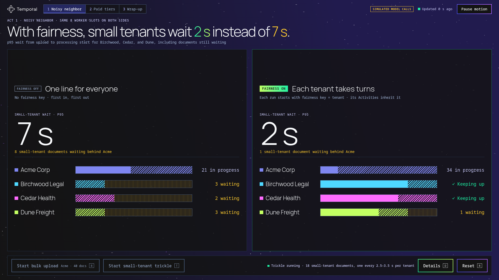

# Temporal Task Queue Fairness demo



One tenant's 2,000-document bulk upload lands on a shared AI document pipeline. Without fairness, every other tenant's documents wait behind it. With [Task Queue Fairness](https://docs.temporal.io/develop/task-queue-priority-fairness), they start within seconds.

What's in it:

- Two identical Task Queues side by side. `docs-fifo` has no fairness keys; `docs-fair` gives each tenant a fairness key and a weight from its plan.
- One [temporal-agent-harness](https://pypi.org/project/temporal-agent-harness/) agent run per document. The agent reads the document, then calls the extract, classify and summarize tools. Each tool is an Activity.
- [Priority and fairness](https://docs.temporal.io/develop/python/temporal-client#priority) set once, when the Workflow starts. The agent's Activities inherit the key and weight, so the agent code never sets them.
- [Update-With-Start](https://docs.temporal.io/develop/python/message-passing#update-with-start) for every document upload, Signal-With-Start for the presenter's controls, and [Visibility](https://docs.temporal.io/visibility) List for the live view.
- A presenter dashboard in the Temporal dark theme: a low-density main view, a details drawer, a weights act and a wrap-up card.

The model call is **simulated**. It sleeps for a fixed 1.5 s and returns canned tool calls, so every run takes the same time and needs no API keys. The UI shows a "Simulated model calls" badge.

## How it works

| Tenant | Plan | Fairness weight |
|---|---|---|
| Acme Corp | Enterprise | 5 |
| Birchwood Legal | Pro | 2 |
| Cedar Health | Starter | 1 |
| Dune Freight | Starter | 1 |

1. **Act 1: the noisy neighbour.** The presenter clicks **Bulk upload** and Acme uploads 2,000 documents to both queues at once. Then **Start trickle** sends Birchwood, Cedar and Dune documents one at a time, every 18 to 26 seconds, to both queues. On `docs-fifo` they queue behind Acme's backlog. On `docs-fair`, the matching service gives each fairness key its share of the 8 Worker slots, so a Cedar document starts almost as soon as it arrives.
2. **Act 2: weights.** Every tenant uploads 500 documents to the fair queue. The share of documents each tenant starts follows its weight: 5 / 2 / 1 / 1. The presenter can edit the weights before the upload.
3. **Wrap-up.** A card compares the small tenants' p95 wait with and without fairness, Acme's total time, and the shares from Act 2.

A document's wait is the time from upload to the start of its model call. The dashboard refreshes about once a second.

| Component | Command | What it does |
|---|---|---|
| Temporal | `scripts/dev-server.sh` | Dev server with fairness enabled and the demo's Search Attributes |
| Worker | `python -m fairness_demo.worker` | Two document Workers (`docs-fifo`, `docs-fair`) with 8 Activity slots each, plus the control Worker for uploads and settings |
| API and UI | `python -m fairness_demo.api` | FastAPI app that serves the dashboard on port 8080 |

The `UploadScenario` Workflow runs the uploads, so a bulk upload or a trickle survives an API restart. Its `upload_documents` Activity starts each document with Update-With-Start and heartbeats its progress. The `WorkerSettings` Workflow holds the slot count. The Worker reads it with Describe and restarts its document Workers when it changes.

## Prerequisites

- [Temporal CLI](https://docs.temporal.io/cli) 1.4 or later
- [uv](https://docs.astral.sh/uv/)

## Run it

In three terminals, from the repository root:

```bash
scripts/dev-server.sh
```

```bash
uv run python -m fairness_demo.worker
```

```bash
uv run python -m fairness_demo.api
```

Open http://127.0.0.1:8080. The Temporal UI is at http://localhost:8233.

| Control | Key | What it does |
|---|---|---|
| Bulk upload | `B` | Act 1: Acme uploads its bulk batch to both queues. Act 2: every tenant uploads to the fair queue |
| Start trickle | `T` | Small tenants upload one document at a time to both queues |
| Details | `D` | Opens the drawer: backlog, completions, tenants, Cedar's view (`1`–`4` switch tabs, `Esc` closes) |
| Reset | `R` | Starts a fresh run, terminates the old run's Workflows and applies a new slot count |
| Act 1 / Act 2 / Wrap-up | `1` `2` `3` | Switch acts when the drawer is closed |

**Pause motion** in the header stops the starfield and animations.

For a quick rehearsal, scale it down before starting the Worker and API:

```bash
export ACME_BULK_DOCS=40 TIERED_DOCS_PER_TENANT=60
export TRICKLE_INTERVAL_S=birch=2.5,cedar=3.5,dune=3
```

## Tuning

Set these in the environment of both the Worker and the API.

| Variable | Default | Meaning |
|---|---|---|
| `ACME_BULK_DOCS` | `2000` | Acme's bulk upload in Act 1 |
| `TRICKLE_DOCS` | `birch=7,cedar=5,dune=6` | Documents each small tenant uploads in the trickle |
| `TRICKLE_INTERVAL_S` | `birch=18,cedar=26,dune=22` | Seconds between each small tenant's uploads |
| `TIERED_DOCS_PER_TENANT` | `500` | Each tenant's upload in Act 2 |
| `WORKER_SLOTS` | `8` | Starting Activity slots per queue. The dashboard changes it on Reset, up to 32 |
| `SIM_MODEL_SECONDS` | `1.5` | Simulated model call |
| `SIM_TOOL_SECONDS` | `0.5` | Each simulated tool |
| `TASK_QUEUE` | `docs` | Base name: `<base>-fifo`, `<base>-fair`, `<base>-control` |
| `TEMPORAL_ADDRESS`, `TEMPORAL_NAMESPACE`, `TEMPORAL_API_KEY`, `TEMPORAL_TLS*` | `localhost:7233`, `default` | Temporal connection. The demo reads env vars only and ignores CLI profile files |
| `API_HOST`, `PORT` | `127.0.0.1`, `8080` | API bind address |
| `SESSION_SECRET` | random per process | Signs the session cookie. Set it when the API runs as more than one replica or must keep sessions across restarts |
| `TEMPORAL_UI_URL` | `http://localhost:8233` | Target of the dashboard's Temporal UI links |

## Temporal Cloud

- Turn on Fairness for the namespace, and add the Search Attributes `DocSession` (Keyword), `DocTenant` (Keyword) and `DocStartedAt` (Datetime).
- Each document costs about 13 Actions: 2 for Update-With-Start, 4 Activities, 1 Search Attribute upsert, and 6 Signals that the agent harness sends to publish each tool's start and end events. A default Act 1 is 4,000 documents across both queues, about 52,000 Actions. A default Act 2 is 2,000 documents, about 26,000.
- The dashboard reads Visibility List and Describe, which aren't Actions. It runs no Queries.

## Catalog readiness

- **Sessions.** Each browser gets a signed `fairness_session` cookie. The tab picks a run ID, kept in `sessionStorage`. Every Workflow ID, List query, upload and reset is scoped to `fairness-<TASK_QUEUE>-<session>-<run>`.
- **Routes.** `/` serves the dashboard. `/api/settings`, `/api/runs/{run}/view` and `POST /api/runs/{run}/{bulk,trickle,tiered,reset}` are public. There are no internal routes.
- **Smoke check.** `GET /healthz` checks the Temporal connection without changing any state.
- **Build.** One `Dockerfile` builds both processes. The API is the default command; run the Worker with `python -m fairness_demo.worker`.
- **Secrets.** `SESSION_SECRET` and the Temporal credentials.

## Notes

- **Shared Workers.** Every session shares the same two document Workers and their 8 slots, and the slot count is global. That is the point of a capacity demo, but two people running it at once will slow each other down. Give each crashable workspace its own `TASK_QUEUE`.
- **Late completions on the FIFO side.** On `docs-fifo`, a document's tool Activities queue behind the whole remaining backlog, not just its model call. Completions lag starts, which the completions chart shows.
- **Act 1 uses plan weights.** Act 1 already runs with weights 5 / 2 / 1 / 1. The small tenants still start quickly because each one has documents waiting only now and then.
- **Start time.** The Workflow records `DocStartedAt` when the model call returns. For small-tenant documents that are still running, the API reads the model call's start time with Describe, so their wait is exact.
- **Closing the agent.** temporal-agent-harness 0.7.0 exposes close only as a Signal, and a Workflow can't Signal itself. The agent calls the runner's internal `_handle_close()` after the document is processed.
- **Reset.** Reset terminates the old run's Workflows with one batch operation. For a few seconds, terminating Workflows can hold Worker slots while the next run starts.
- **Not yet verified.** The full 2,000-document run, the Docker image and the `DemoProject` resource haven't been tested.
